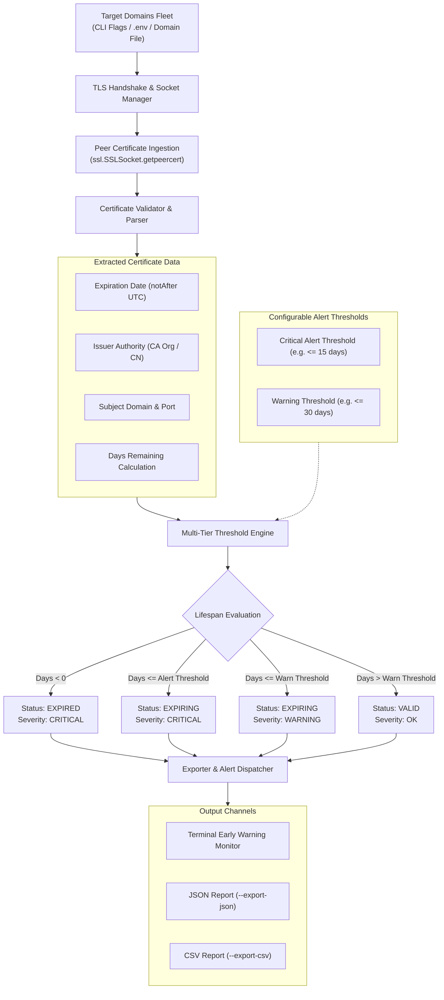

# 🛡️ ssl-expiry-guard

> **Topics:** `ssl-certificate` `tls` `expiry-monitor` `devops` `sysadmin` `security-audit` `uptime-monitoring`


[](https://github.com/MobileConduit/ssl-expiry-guard/releases/tag/v1.0.0)
[](LICENSE)
[](https://github.com/MobileConduit)
[](https://github.com/MobileConduit/ssl-expiry-guard/actions)
[](https://python.org)
[](https://en.wikipedia.org/wiki/Transport_Layer_Security)

Proactive fleet SSL certificate expiration inspector built to eliminate unplanned service outages. Queries TLS handshakes across hundreds of domain names in seconds, evaluates remaining lifespan against multi-tier thresholds, alerts on imminent certificate expirations, and exports audit reports to JSON and CSV.

---

## 🏗️ Architecture & Inspection Flow



---

## ✨ Key Features

- **Fleet Certificate Inspection:** Fast, non-blocking TLS inspection across large lists of enterprise domains.
- **Multi-Tier Early Warning Thresholds:** Configurable `CRITICAL` (default: 15 days) and `WARNING` (default: 30 days) alerts.
- **Zero External Dependencies:** Built entirely with Python's standard library (`ssl`, `socket`, `datetime`, `json`, `csv`, `argparse`, `pathlib`).
- **Structured JSON & CSV Exports:** Generate audit-ready artifacts for SIEM, Prometheus blackbox, or uptime monitors.
- **Robust Exception Handling:** Gracefully handles socket timeouts, DNS resolution failures, and handshake errors without terminating the fleet scan.
- **Flexible Target Ingestion:** Accept domains via CLI arguments, comma-separated environment variables, or line-delimited text files.
- **Automated Test Suite:** Complete unit tests covering certificate parsing, date calculations, socket timeout mocking, and report exports.
- **GitHub Actions CI/CD:** Matrix testing pipeline validating Python 3.10, 3.11, and 3.12.

---

## 🚀 Quick Start

### Installation

Clone the repository:
```bash
git clone https://github.com/MobileConduit/ssl-expiry-guard.git
cd ssl-expiry-guard
```

No external dependencies required!

### Basic Usage

Audit target domains:
```bash
python expiry_guard.py --domains enterprise.com cloud.enterprise.com streaming.net
```

---

## ⚙️ Configuration & Environment Variables

Copy the provided sample environment file:
```bash
cp .env.example .env
```

| Variable | Description | Default |
|:---|:---|:---|
| `DOMAINS` | Comma-separated domain names | `google.com,github.com,cloudflare.com` |
| `ALERT_THRESHOLD_DAYS` | Critical alert threshold in days | `15` |
| `WARN_THRESHOLD_DAYS` | Warning alert threshold in days | `30` |
| `DEFAULT_PORT` | Target port number for TLS inspection | `443` |
| `CHECK_TIMEOUT` | Network socket timeout in seconds | `5.0` |
| `EXPORT_FORMAT` | Default output format (`table`, `json`, `csv`) | `table` |
| `EXPORT_PATH` | Target file path for exported reports | `ssl_report.json` |

---

## 🖥️ CLI Usage & Flags

```bash
python expiry_guard.py [options]
```

### Options Reference

| Flag | Short | Description | Example |
|:---|:---:|:---|:---|
| `--domains` | `-d` | Space or comma-separated domains list | `-d site1.com site2.com` |
| `--file` | `-f` | Text file containing domains (one per line) | `-f domains.txt` |
| `--alert-threshold` | `-a` | Critical alert threshold in days | `-a 20` |
| `--warn-threshold` | `-w` | Warning threshold in days | `-w 45` |
| `--port` | `-p` | Custom port number | `-p 8443` |
| `--timeout` | `-t` | Network socket timeout in seconds | `-t 10.0` |
| `--export-json` | | Path to export findings as JSON | `--export-json ssl_report.json` |
| `--export-csv` | | Path to export findings as CSV | `--export-csv ssl_report.csv` |
| `--format` | | Output format (`table`, `json`, `csv`) | `--format json` |
| `--help` | `-h` | Show help message and exit | `-h` |

### Examples

**Audit a fleet from a file with strict 30-day critical threshold and export to CSV:**
```bash
python expiry_guard.py -f fleet_domains.txt -a 30 -w 60 --export-csv cert_audit.csv
```

**Generate JSON report for automated monitoring systems:**
```bash
python expiry_guard.py -d cloudflare.com github.com google.com --export-json certs.json
```

---

## 🧪 Automated Testing

Execute the automated test suite using Python's built-in `unittest` runner:

```bash
python -m unittest discover -s tests -p "test_*.py" -v
```

The test suite validates:
- Peer certificate dictionary parser against valid, warning, critical, and expired certificates
- Calculation of remaining lifespan in UTC
- Extraction of Certificate Authority (CA) issuer details
- Mocked TLS handshakes and socket connection flows
- Socket timeout and network failure error handling
- JSON and CSV output integrity
- Environment variable configuration loader

---

## 👤 Author & Maintainer

**Eng. MHD. Shadi AL-Hasan**  
- **Role:** Executive CTO & Enterprise Solutions Architect  
- **Email:** [mhd.shadi.alhasan@gmail.com](mailto:mhd.shadi.alhasan@gmail.com)  
- **Phone / WhatsApp:** [+963934005922](tel:+963934005922)  
- **Location:** Damascus, Syria  
- **GitHub:** [MobileConduit](https://github.com/MobileConduit)  

---

## 📄 License

This project is licensed under the MIT License - see the [LICENSE](LICENSE) file for details.  
Copyright (c) 2026 **MHD. Shadi AL-Hasan**. All rights reserved.